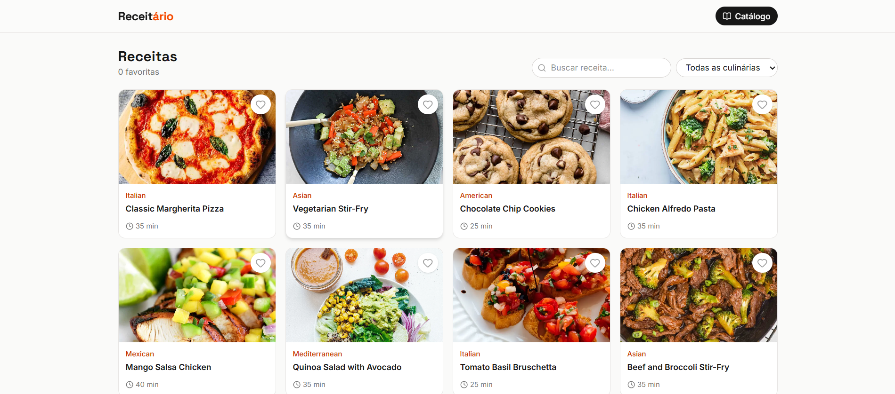

# Receitário

Catálogo de receitas feito com React, Vite e TypeScript, usando a API da DummyJSON.

**Deploy:** https://cp5-front-end.vercel.app

## Integrantes

- Gustavo Mendes da Rosa Moreira - RM 565807
- Leonardo de Souza Bernardo - RM 570951
- Luiz Guedes - RM 565843